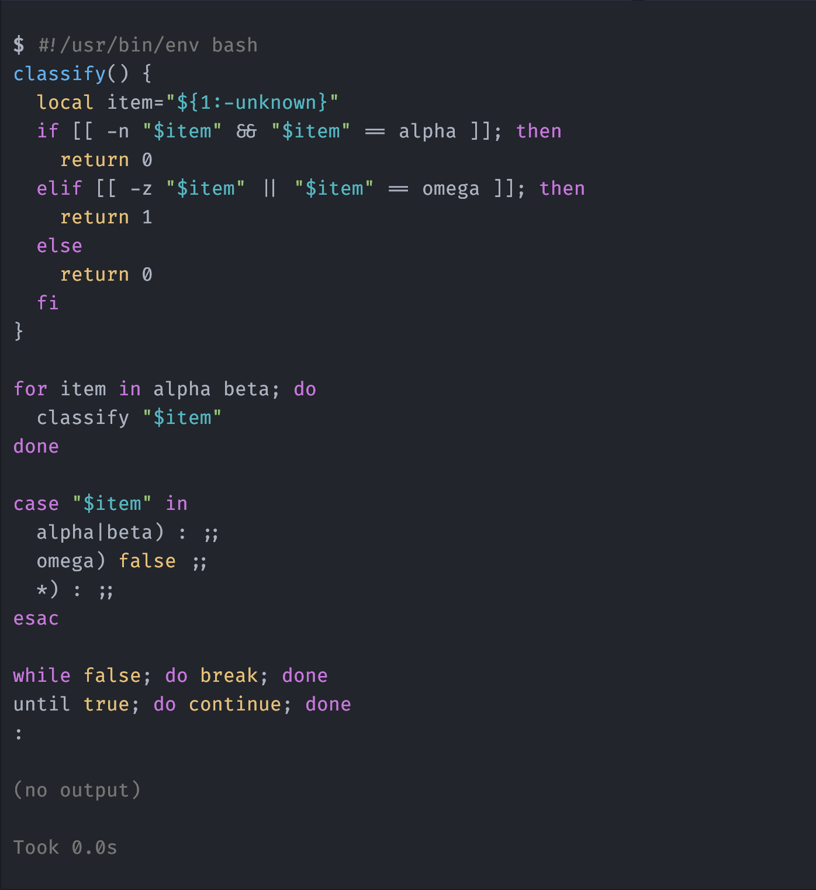

<div align="center">

# pi-pretty-bash

> **Bash tool calls should look like Bash.**

[](https://github.com/earendil-works/pi)
[](https://www.npmjs.com/package/@giladbarnea/pi-pretty-bash)
[](LICENSE)
[](https://www.typescriptlang.org/)

`pi-pretty-bash` adds theme-aware syntax colors to Bash tool calls and JSON output in Pi's TUI.

</div>

<p align="center">
  
</p>

## Install

```sh
pi install npm:@giladbarnea/pi-pretty-bash
```

Start a new Pi session, or run `/reload` in the current session. Every later Bash tool call is highlighted automatically.

## Bash commands and JSON output get syntax colors

The extension registers Bash renderers through Pi's `registerToolRenderer()` API without replacing Bash parameters or execution. It highlights the visible command with Pi's Bash colors.

After a command finishes, valid JSON up to 200 KiB gets Pi's JSON colors without reformatting. Larger output keeps Pi's native rendering without cutting its content. All other output keeps Pi's built-in rendering.

Pi still owns command execution, streaming output, timing, truncation, expansion, and error display.

## Compatibility

`pi-pretty-bash` targets Pi `1.4.*`. Other extensions can own the Bash tool and add parameters without changing this rendering.

## License

[MIT](LICENSE)
